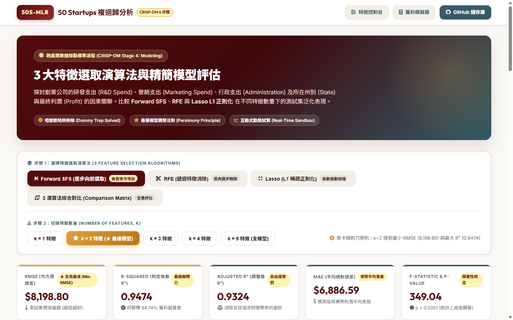

# 50 Startups 複迴歸分析與 3 大特徵選取互動網站

🔗 **線上互動網站 (Live Demo)：** [https://dorachang0402.github.io/AIIS_DIC02_1019/](https://dorachang0402.github.io/AIIS_DIC02_1019/)

---



---

## 📌 專案簡介 (Project Overview)
本專案針對 **50 Startups** 資料集進行多元線性迴歸 (Multiple Linear Regression) 分析，探討研發支出 (R&D Spend)、行銷支出 (Marketing Spend)、行政支出 (Administration) 及所在州別 (State) 對企業淨利潤 (Profit) 的影響。

深入比較 **3 種特徵選取演算法** 在不同特徵數量 ($k=1 \sim 5$) 下的泛化能力與模型表現：
1. **Forward SFS**（逐步向前選取，貪婪逐次增加最佳特徵）
2. **RFE**（遞迴特徵消除，反向逐步剔除最不重要特徵）
3. **Lasso (L1 正則化)**（自動將不具代表性特徵之係數收縮至 0）

---

## 🌟 核心功能亮點 (Key Features)
- **演算法即時切換**：自由切換 3 大演算法與全景橫向評比矩陣。
- **動態特徵階數選取 ($k=1 \sim 5$)**：即時更新 5 項關鍵指標（RMSE、R²、Adjusted R²、MAE、F-statistic）。
- **互動迴歸方程式與係數表**：展示完整未標準化係數、Standard Error、t-stat、p-value 及共線性 VIF 檢驗。
- **獲利預測模擬沙盒 (Profit Simulator)**：提供動態滑桿與 3 款典型預設情境（高研發創新型、均衡成長型、高行銷驅動型），滑桿會隨特徵選取狀態自動鎖定或啟用。
- **殘差診斷與 CRISP-DM 流程**：遵循跨產業數據探勘標準流程，呈現嚴謹的迴歸假設驗證。

---

## 🏆 最佳模型結論 (Parsimony Principle)
依據**奧卡姆剃刀原則 (Occam's Razor)** 與測試集驗證：
- **最佳模型**為 **$k=2$ 特徵模型**（**R&D Spend** + **Marketing Spend**）。
- 達成全局最低測試集誤差 **RMSE = $8,198.80**，判定係數 **$R^2 = 0.9474$**。
- 行政支出 (Administration) 與地理州別虛擬變數在統計檢定下未達顯著水準 ($p > 0.05$)，剔除後可顯著降低模型複雜度並避免過擬合。

---

## 🎨 網站專屬色系 (Color Palette)
- 🟢 **Dark Slate Grey**: `#335c67`
- 🟡 **Vanilla Custard**: `#fff3b0`
- 🟠 **Honey Bronze**: `#e09f3e`
- 🔴 **Brown Red**: `#9e2a2b`
- 🍷 **Night Bordeaux**: `#540b0e`

---

## 🚀 本地端運行 (Local Quick Start)
本專案為輕量純前端架構（Vanilla HTML/CSS/JS + Chart.js），無需建置環境，亦可啟動靜態伺服器：
```bash
# 使用 Python 內建 HTTP 伺服器
python -m http.server 8000
```
開啟瀏覽器前往：`http://localhost:8000/index.html`
